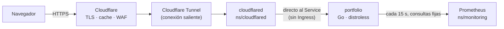

# portfolio

Mi portafolio: **https://marlon.mihomeserver.com**. Corre en un clúster k3s en mi casa, el mismo del repo `home-server`.

- **Sitio:** Astro, 100 % estático, en español e inglés, con tema claro y oscuro, terminal interactiva (<kbd>`</kbd>) y panel en vivo del servidor.
- **Servidor:** un binario de Go sin dependencias externas que embebe el sitio, aplica las cabeceras de seguridad, elige el idioma y sirve `/api/status`.
- **Imagen:** distroless `static:nonroot`, ~24 MB, sin shell.

## Cómo llega una petición



- **Idioma de la primera visita** (`GET /`): cookie `lang` elegida por el visitante → país de Cloudflare (`CF-IPCountry`: hispanohablante → `/es/`, el resto → `/en/`) → `Accept-Language`. Al cambiar de idioma en la página se guarda la cookie.
- **Tema:** el del sistema hasta que el visitante elige; la elección queda en `localStorage`.

## Seguridad

| Capa | Medida |
|---|---|
| Red | Sin puertos abiertos en casa: solo el túnel saliente. Sin `Ingress`: Traefik no enruta este host, así que nadie desde la LAN o Tailscale puede falsificar `CF-Connecting-IP`. NetworkPolicy en `home-server`: entrada solo desde `cloudflared` y `gatus`; salida solo a Prometheus y DNS. |
| Pod | `runAsNonRoot` (65532), `readOnlyRootFilesystem`, sin capabilities, `seccomp: RuntimeDefault`, sin token de ServiceAccount, límites de memoria. |
| Imagen | Distroless static, base fijada por digest, binario `-trimpath` sin CGO. SBOM y provenance en cada release. |
| HTTP | CSP sin `unsafe-inline`/`unsafe-eval` y con Trusted Types; HSTS, `nosniff`, `frame-ancestors 'none'`, COOP/CORP, Permissions-Policy. Solo `GET`/`HEAD`. Sin listados de directorio ni rutas ocultas. Timeouts y tope de cabeceras. |
| Abuso | Límite por IP en memoria con tope de tamaño (30 req/s general, 1 cada 2 s en `/api/status`). Las visitas **nunca** disparan consultas a Prometheus: un proceso en segundo plano refresca una instantánea cada 15 s. |
| Datos | `/api/status` publica solo agregados del nodo: sin nombres de pods, namespaces, IP ni versión de kernel (lo comprueba un test). |
| Cliente | Sin dependencias de terceros en el navegador, fuentes servidas desde el propio dominio, sin cookies de seguimiento. La terminal construye la salida con `textContent`: lo que escribe el visitante nunca se interpreta como HTML. |
| Cadena de suministro | Acciones de GitHub fijadas por SHA, `npm audit` y `govulncheck` en CI, Dependabot semanal, versiones exactas en `package.json`. |

Las capturas de los proyectos se tomaron en local con **datos de demostración**.

## Desarrollo

```bash
nvm use          # Node 24
npm ci
npm run dev      # http://localhost:4321/es/ (sin el servidor Go: el panel sale "sin datos")
```

Con el servidor Go y datos reales (necesita `kubectl` contra el clúster):

```bash
kubectl -n monitoring port-forward svc/kps-prometheus 19090:9090 --address 0.0.0.0
docker build -t portfolio:local .
docker run --rm --read-only --cap-drop ALL -p 8080:8080 \
  -e PROMETHEUS_URL=http://host.docker.internal:19090 portfolio:local
```

Pruebas del servidor: `cd server && go test ./...` (necesita una carpeta `server/public/`; el Dockerfile la rellena con el build).

Imagen para redes sociales: `node scripts/og.mjs` regenera `public/og.png`.

## Publicar una versión

```bash
git tag v0.2.0 && git push origin v0.2.0
```

`release.yml` corre el CI, publica `ghcr.io/marlon56115/portfolio:0.2.0` y, si el repo tiene el secret `HOME_SERVER_TOKEN`, abre y fusiona el PR que sube la versión en `home-server` (`k8s/apps/portfolio/source.yaml`). Sin ese secret, el PR se hace a mano. Flux despliega al fusionar.

## Estructura

```
src/            sitio Astro (i18n/content.ts tiene todo el texto en los dos idiomas)
server/         servidor Go (handler, limitador, colector de Prometheus y tests)
chart/          chart de Helm que usa Flux
public/         archivos estáticos (theme-init.js, favicon, og.png, security.txt)
```
